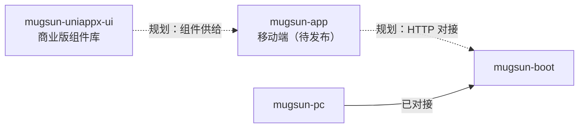

# mugsun-app

**中文** | [English](README_EN.md)

[](https://github.com/mugsun/mugsun-app)
[](https://github.com/mugsun/mugsun-app)

mugsun 平台的**移动端应用仓库**（规划对接 [mugsun-boot](https://github.com/mugsun/mugsun-boot)）。公开仓库当前**仅有本说明文件**，尚未包含可构建的应用源码（无 `package.json` / `pages.json` / `manifest` / 业务页面）。

> 旧 README 中的功能列表、平台矩阵与「打开即可跑」步骤已过时，**不得当作现状**。下列内容只陈述仓库事实与产品边界。

## 当前状态

| 项 | 事实（截至本 README） |
| --- | --- |
| 公开内容 | `README.md`、`README_EN.md` |
| 应用源码 | **未发布** |
| LICENSE 文件 | **尚未加入仓库** |
| 可复制的启动命令 | **无**（缺少工程文件） |
| 与 boot 的联调说明 | 待源码落地后补充（鉴权、环境变量、API 基址等以届时代码为准） |

仓库 GitHub 描述仍写明意向：基于 **uni-app x**，面向 Android / iOS / 鸿蒙 / 小程序，对接 mugsun-boot。该描述是产品方向，**不是**对本仓已有代码的验收结论。

## 在平台中的位置

与其它仓**平级 clone**（应用源码发布后同样如此）：

```text
mugsun/
├── mugsun-core      # BOM + starter
├── mugsun-boot      # 后端（HTTP / WebSocket）
├── mugsun-pc        # PC 管理台
├── mugsun-track     # Web 埋点 SDK
├── mugsun-docs      # 文档站 https://docs.mugsun.com/
└── mugsun-app       # 本仓（移动端 · 源码待发布）
```



相关但**未开源 / 不在本仓**：

- `mugsun-uniappx-ui`（商业版，源码不公开）— uni-app x 组件库；使用文档见 [文档站 ms-ui 章节](https://docs.mugsun.com/uniappx/)。
- [mugsun-uniappx-sdk](https://github.com/mugsun/mugsun-uniappx-sdk)（私有）— UTS / SDK 扩展意向。

不要把上述私有仓写成「克隆本仓即可安装」。

## 源码发布前你可以做什么

1. 先跑通后端与管理台：见 [mugsun-boot](https://github.com/mugsun/mugsun-boot)、[mugsun-pc](https://github.com/mugsun/mugsun-pc) 与文档 [快速开始](https://docs.mugsun.com/guide/getting-started)。
2. 关注本仓后续提交；源码落地后，本 README 会改为真实工程结构、环境变量与启动步骤（只写代码里存在的内容）。
3. 文档站：[https://docs.mugsun.com/](https://docs.mugsun.com/) · 品牌站：[https://mugsun.com](https://mugsun.com)

## 许可证

仓库内尚无 `LICENSE` 文件。开源许可将在应用源码一并发布时确定；在此之前请勿假设为 MIT 或其它协议。

---

维护说明：本 README 随「源码是否进仓」更新；有工程文件后再写快速开始与平台/环境细节。

© 2026 北京定旭晨 / mugsun
