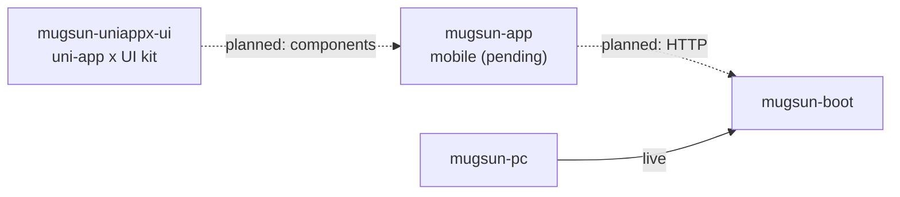

# mugsun-app

[English](README_EN.md) | **简体中文** ([README.md](README.md))

[](https://github.com/mugsun/mugsun-app)
[](https://github.com/mugsun/mugsun-app)
[](./LICENSE)

Reserved repository for the **mugsun mobile client**, intended to talk to [mugsun-boot](https://github.com/mugsun/mugsun-boot). The public tree currently contains **only these README files** — no buildable app sources (`package.json`, `pages.json`, `manifest`, or feature pages).

> Older README claims (feature lists, platform matrix, “open and run” steps) are outdated and **must not** be treated as fact. Below is only what the repository and product boundary actually show.

## Current status

| Item | Fact (as of this README) |
| --- | --- |
| Public contents | `README.md`, `README_EN.md`, `LICENSE` |
| Application source | **Not published** |
| License | [MIT](./LICENSE) |
| Copy-paste run commands | **None** (no project files) |
| Boot integration guide | To be added when source lands (auth, env, API base — only from real code) |

The GitHub description still states the **intent**: **uni-app x**, targeting Android / iOS / HarmonyOS / mini programs, backed by mugsun-boot. That is product direction, **not** a claim that this repo already ships that code.

## Place in the platform

Clone **side by side** with the other repos (same layout once sources exist):

```text
mugsun/
├── mugsun-core      # BOM + starters
├── mugsun-boot      # backend (HTTP / WebSocket)
├── mugsun-pc        # PC admin
├── mugsun-track     # Web analytics SDK
├── mugsun-docs      # docs site https://docs.mugsun.com/
└── mugsun-app       # this repo (mobile · source pending)
```



Related, with **source repositories not public / not in this repo**:

- `mugsun-uniappx-ui` (MIT, source repository not yet public) — uni-app x component library; see [the ms-ui docs](https://docs.mugsun.com/en/uniappx/) for usage.
- [mugsun-uniappx-sdk](https://github.com/mugsun/mugsun-uniappx-sdk) (MIT, private repository) — UTS / SDK extension intent.

Do not document those private repos as “clone this repo and install.”

## What to do before source is published

1. Run the backend and admin UI first: [mugsun-boot](https://github.com/mugsun/mugsun-boot), [mugsun-pc](https://github.com/mugsun/mugsun-pc), and [Getting started](https://docs.mugsun.com/en/guide/getting-started).
2. Watch this repository for commits; when sources land, this README will describe the real tree, env vars, and run steps — only what the code contains.
3. Docs: [https://docs.mugsun.com/](https://docs.mugsun.com/) · Site: [https://mugsun.com](https://mugsun.com)

## License

[MIT](./LICENSE). Application source will be published under the same license.

---

Maintainer note: refresh this README when application sources enter the tree; add quick start and platform/env details only from those files.